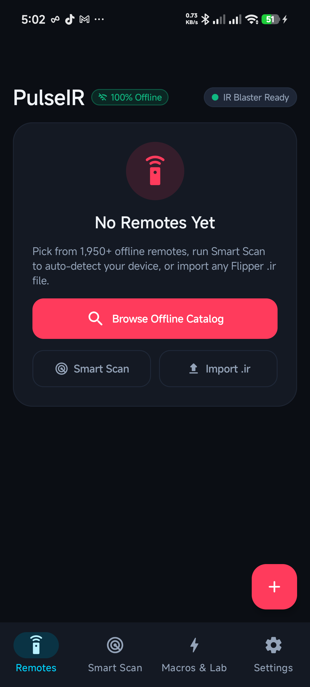

<div align="center">
  
  <h1>PulseIR</h1>
  <p><strong>100% Offline, Open-Source Universal IR Remote for Android</strong></p>
  <p><strong>تطبيق ريموت كنترول عالمي مفتوح المصدر يعمل أوفلاين 100%</strong></p>

  <p>
    
    
    
    
    
  </p>
</div>

---

## Why PulseIR?

Most universal remote apps are bloated with ads, trackers, subscriptions, or require constant internet access. **PulseIR** is built from the ground up with **Kotlin + Jetpack Compose + Material 3** to feel like a machined hardware remote:

- **Zero `INTERNET` Permission:** Completely offline by design. Only uses `TRANSMIT_IR`, optional `VIBRATE`, and optional `POST_NOTIFICATIONS` (only if you pin a remote to the Lock Screen).
- **Massive Built-in Offline Catalog:** **6,031 remotes** and **182,000+ IR buttons** across **19 device categories** — TVs, Air Conditioners, Satellite Receivers / Set-Top Boxes (1,345 models including Strong, Humax, Starsat, Truman, Qmax, Dreambox, TechniSat, Echostar), AV Receivers, Soundbars, Projectors, Fans, LED Strips, Cameras, Heaters, Robot Vacuums, Car Audio, and more.
- **Smart Full-Thermostat AC Engine:** Pure-Kotlin stateful bitstream generator (`AcProtocolEngine`) synthesizing exact checksum-verified frames with per-device state persistence across **7 protocols**: **Coolix** (Carrier, Midea, Tornado, Fresh, Unionaire, York, Beko), **Gree** (Gree, Fresh, Unionaire, Haier, Hisense), **Sharp** (Sharp, Tornado El-Araby), **LG**, **Samsung**, **Toshiba**, and **Daikin**.
- **Lock Screen Control (Mi Remote Style):**
  - **Over Lock Screen:** Keep using your active remote directly over the lock screen without unlocking.
  - **Lock Screen Pin Bar:** Pin a compact mini-remote bar (`⏻ | 🔇 | VOL± | CH±` or AC temperature shortcuts) to your Lock Screen & Notification shade.
  - **Quick Settings Tile:** Launch your latest remote directly from the Android / HyperOS Control Center.
- **Turbo Auto Scan Mode:** Deduplicated, popularity-ranked Power codes with **Turbo (0.25s)**, **Fast (0.45s)**, Normal, and Slow speeds — plus a **Last 5 Codes Rescue Strip** so human reaction delay never ruins a scan.
- **Tactile Hardware UX:** Top-bezel ambient infrared emission pulse glow (`TopIrBeamGlow`), machined bevel buttons, press-and-hold auto-repeat on Volume/Channel/D-Pad, **Hardware Volume Keys** controlling TV volume, and **Long-Press Signal Inspector** with live waveform rendering.
- **Power Tools:**
  - **Custom Remotes:** Multi-tab unified remotes mixing buttons from any saved device, macro, or custom IR code.
  - **Macros:** Chain IR actions with configurable delays in one tap.
  - **Key Finder:** Sweep commands `0x00–0xFF` for any protocol & address to discover and rebuild remotes for obscure devices without needing an IR receiver chip.
  - **Custom IR Lab & `.ir` Importer:** Build Protocol, Pronto Hex, or Raw IR signals with live **Waveform Canvas** preview, or import standard Flipper Zero `.ir` files offline.
  - **Adaptive Home Screen Widget (TV & Smart AC) & Offline JSON Backup/Restore.**
- **Full Bilingual Support:** Native **English (LTR)** & **Arabic (RTL)** — with physical remote geometry (D-Pad, Numpad `1–9`, Media controls) strictly locked to physical layout so arrows and digits never invert in RTL!

---

## Preview

<div align="center">
  
</div>

---

## Supported IR Protocols (Pure Kotlin Engine)

| Family | Protocols |
|---|---|
| **NEC** | `NEC`, `NECext`, `NEC42`, `NEC42ext` |
| **Samsung** | `Samsung32` |
| **Philips** | `RC5`, `RC5X`, `RC6` (with hardware toggle bit) |
| **Sony** | `SIRC` (12-bit), `SIRC15`, `SIRC20` (3× hardware repeat frames) |
| **Japanese / Legacy** | `Kaseikyo` (Panasonic), `RCA`, `Pioneer` |
| **Stateful Smart AC** | `Coolix` (Midea/Carrier/Tornado/Fresh), `Gree`, `Sharp` (Tornado), `LG AC`, `Samsung AC`, `Toshiba AC`, `Daikin AC` |
| **Raw / Learned** | Pronto Hex (`0000 …`), Raw microsecond timings, Carrier cycle conversion, Flipper Zero `.ir` files |

---

## Hardware Compatibility

Works on any Android 7.0+ (API 24+) device with a built-in IR blaster (`android.hardware.consumerir`), including:
- **Xiaomi / Redmi / Poco** (verified live on Xiaomi Redmi Note 15 5G / HyperOS)
- **Honor / Huawei / OnePlus / Oppo / Realme** models with IR emitter
- **Samsung / LG** devices with IR blaster

Devices without an IR blaster run cleanly in preview/offline catalog mode.

---

## Project Structure

```text
PulseIR/
├── app/src/main/
│   ├── assets/pulseir_catalog.db.gz     # Gzip-compressed 100% offline SQLite catalog (6,031 remotes, 6.5 MB)
│   └── java/com/pulseir/remote/
│       ├── ir/                          # 14-protocol IR encoder, 7-protocol Stateful AC engine, Pronto/.ir parser, ConsumerIrManager transmitter
│       ├── data/                        # Offline SQLite catalog repository, local JSON store, backup/restore, preferences
│       ├── lockscreen/                  # Lock-screen notification remote & Quick Settings TileService
│       ├── widget/                      # Home screen 4×1 Quick Remote AppWidget
│       └── ui/                          # Material 3 Compose screens, tactile bevel components, waveform canvas
├── app/src/test/                        # Unit tests for all 14 IR protocols, AC engine, Pronto Hex & .ir parser
└── tools/build_catalog_db.py            # Offline database compiler (Flipper-IRDB + LIRC -> SQLite)
```

---

## Building from Source

### Requirements
- JDK 17
- Android SDK (API 36)

### Commands
```bash
# Run all IR protocol & AC engine unit tests
./gradlew testDebugUnitTest

# Build Debug APK
./gradlew assembleDebug
```

The generated APK will be at `app/build/outputs/apk/debug/app-debug.apk`.

---

## Open-Source Data Credits & License

- **PulseIR** source code is licensed under the **GNU General Public License v3.0** — see [LICENSE](LICENSE).
- Built-in offline IR catalog is compiled from:
  - [Flipper-IRDB](https://github.com/Lucaslhm/Flipper-IRDB) (`CC0-1.0` Public Domain)
  - [Official LIRC Remotes Database](https://sourceforge.net/p/lirc-remotes/code) (`GPL`)

---

<div align="center">
  <p><strong>Crafted with ❤️ by Islam Ahmed Mohamed</strong></p>
  <p><strong>صُنع بكل ❤️ بواسطة إسلام أحمد محمد</strong></p>
</div>
